

  <picture>
    <source media="(prefers-color-scheme: light)" srcset="assets/hero-light.svg">
    
  </picture>

  <a href="https://github.com/acob-lighting-technology-limited/acob-erp">
    <picture>
      <source media="(prefers-color-scheme: light)" srcset="assets/p-erp-light.png">
      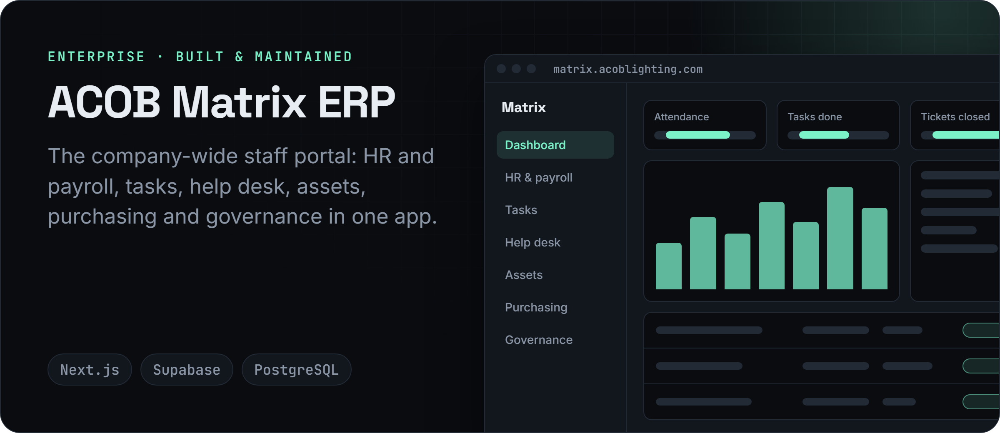
    </picture>
  </a>

  <a href="https://www.acoblighting.com">
    <picture>
      <source media="(prefers-color-scheme: light)" srcset="assets/p-web-light.png">
      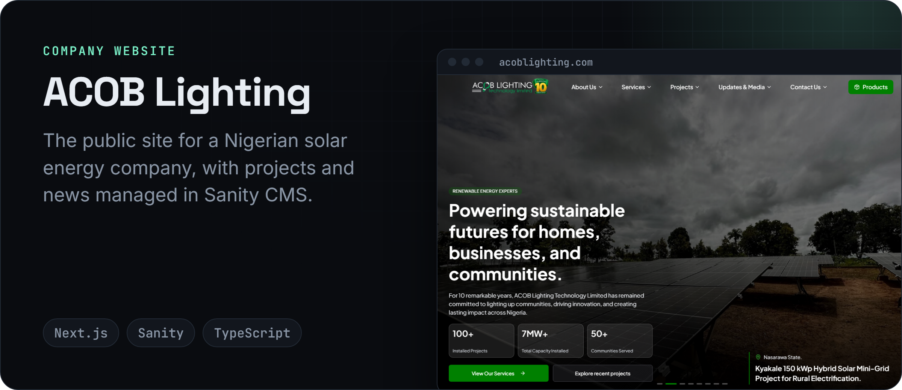
    </picture>
  </a>

  <a href="https://stellarcade.xyz">
    <picture>
      <source media="(prefers-color-scheme: light)" srcset="assets/p-stellarcade-light.png">
      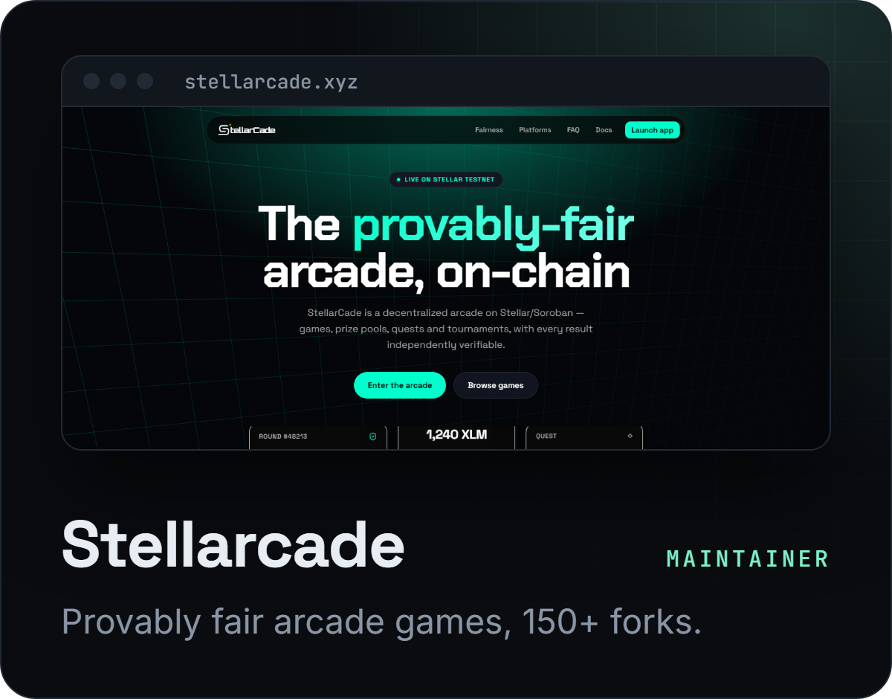
    </picture>
  </a>
  <a href="https://sylox.xyz">
    <picture>
      <source media="(prefers-color-scheme: light)" srcset="assets/p-sylox-light.png">
      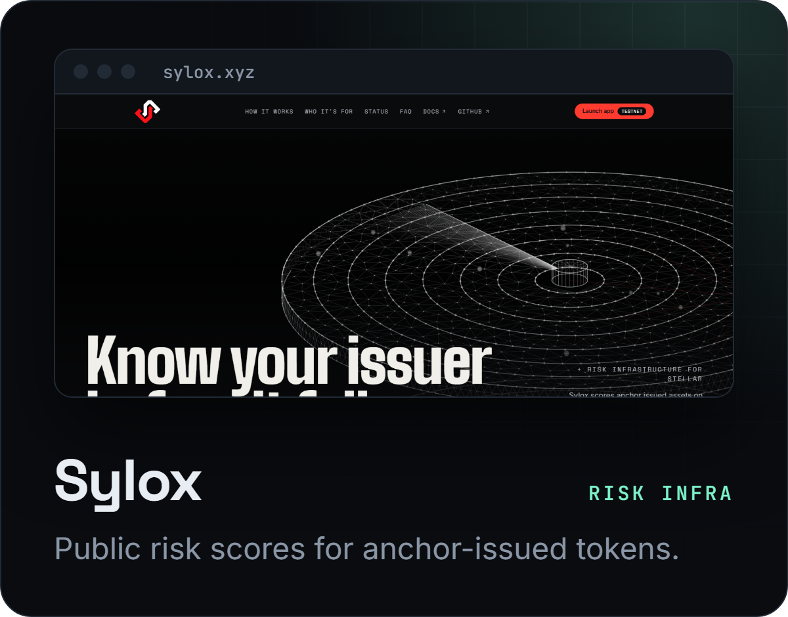
    </picture>
  </a>

  
<b>More projects</b>

   

  - [**Lumenline**](https://github.com/lumenline-labs/lumenline): SDK, relayer and widget for moving USDC and USDT0 between Stellar and other chains
  - [**StellarFreight**](https://stellarfreight.vercel.app): cross-border freight booking with USDC payments and escrow settlement

  <picture>
    <source media="(prefers-color-scheme: light)" srcset="assets/stats-light.svg">
    
  </picture>

  <picture>
    <source media="(prefers-color-scheme: light)" srcset="assets/stack-light.png">
    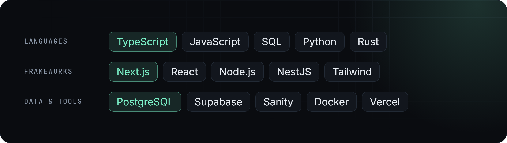
  </picture>

  <a href="https://github.com/CMI-James"><picture><source media="(prefers-color-scheme: light)" srcset="assets/c-github-light.png">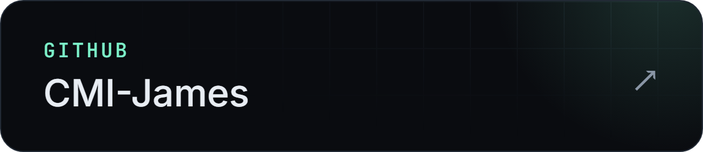</picture></a>
  <a href="https://www.linkedin.com/in/chibuikem-ilonze-7397a522a"><picture><source media="(prefers-color-scheme: light)" srcset="assets/c-linkedin-light.png">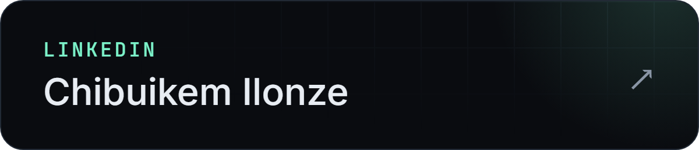</picture></a>
  <a href="https://x.com/cmi_james"><picture><source media="(prefers-color-scheme: light)" srcset="assets/c-x-light.png">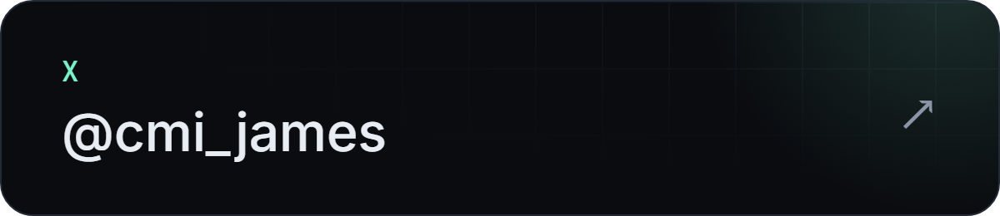</picture></a>
  <a href="https://cmi-james.vercel.app"><picture><source media="(prefers-color-scheme: light)" srcset="assets/c-site-light.png">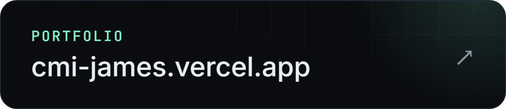</picture></a>

